<picture>
  <source media="(prefers-color-scheme: dark)" srcset="assets/banner-dark.svg">
  
</picture>

I build web and mobile products, mostly software for operations teams. I've been at it since 2019, from Florianópolis, for companies in the US and Brazil.

### Right now

- Senior Software Engineer at [ReSpark](https://respark.com), on the software 800+ scrap metal companies use to run their yards
- Founder of [Zaintech](https://zaintech.com.br)

### Before

Almost five years at [AvantStay](https://avantstay.com), first as a Senior Software Engineer and then as Tech Lead of the engineering team, working mostly with the operations side. Some of the work from there:

- Developed and maintained the React Native app used by 2,000+ field vendors
- Built an LLM service that reads hundreds of guest reviews a day and turns them into maintenance requests
- Was part of the team that moved operations off Salesforce, saving about $250K a year

Earlier I worked on an NFL NFT marketplace on the Flow blockchain at Popstand, where I led one of the teams, and on client projects at Jungle Devs.

### Side projects

- [Embromation](https://github.com/jaugustodafranca/embromation): a macOS menu bar app that translates selected text with a model running on your own Mac. The name is Brazilian slang for faking your way through English.
- [MyPRs](https://github.com/jaugustodafranca/myprs): your open GitHub pull requests in the macOS menu bar, with CI and review status.
- [Keybinder](https://keybinder.app): global keyboard shortcuts that send the text you selected to ChatGPT, Claude or Gemini.
- [Ajuda Fraterna](https://ajudafraterna.com.br): a platform where doctors, dentists, lawyers and other professionals volunteer to help people who can't pay, with partner institutions covering costs when needed.

### Stack

**Main:** TypeScript, JavaScript, React, Next.js, React Native, Expo, Node.js, GraphQL

**Also worked with:** Tailwind CSS, Material UI, styled-components, Redux, MobX, Apollo, Hasura, Fastify, Prisma, Supabase, Electron, Jest, Cypress, Playwright, Vitest, Storybook, AWS, Vercel, Cloudflare Workers, Docker, GitHub Actions, GitLab CI, Datadog, Sentry, OpenAI, Claude and Gemini APIs

